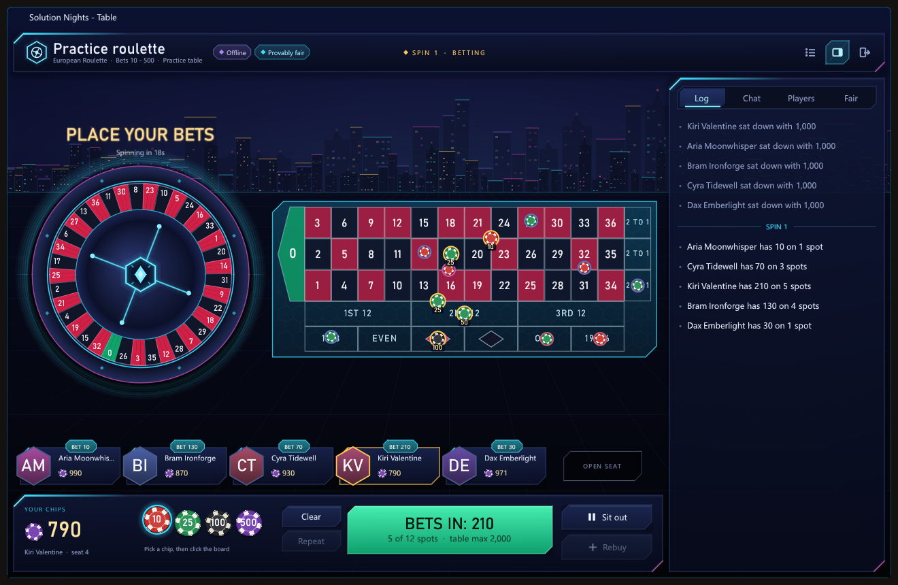
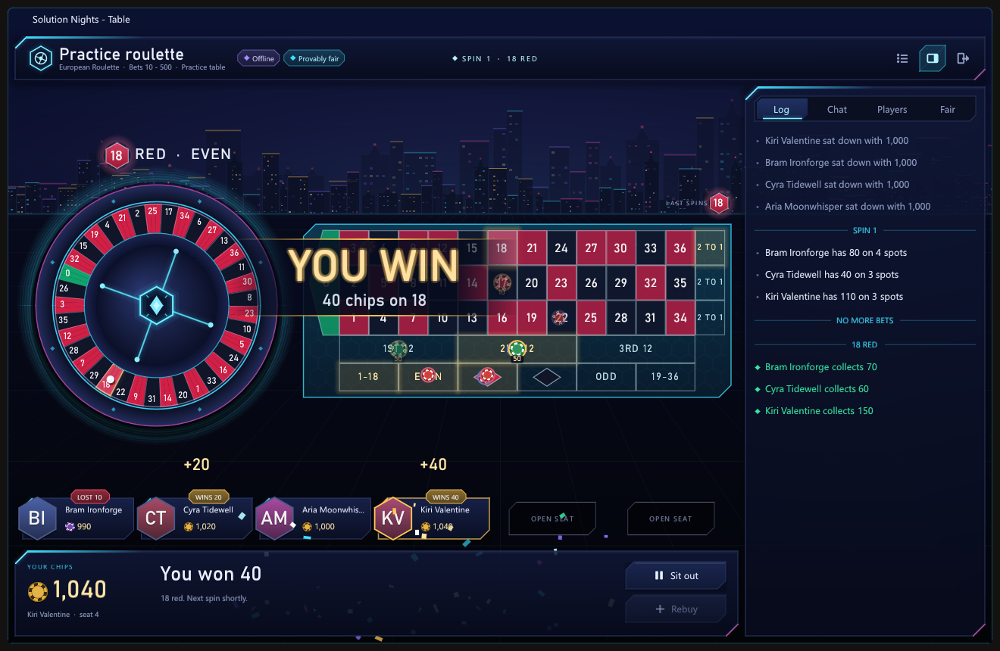
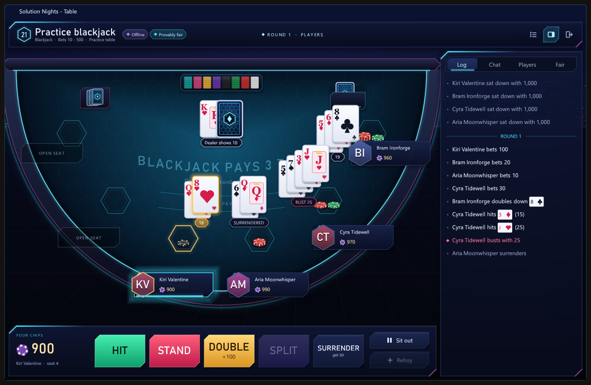
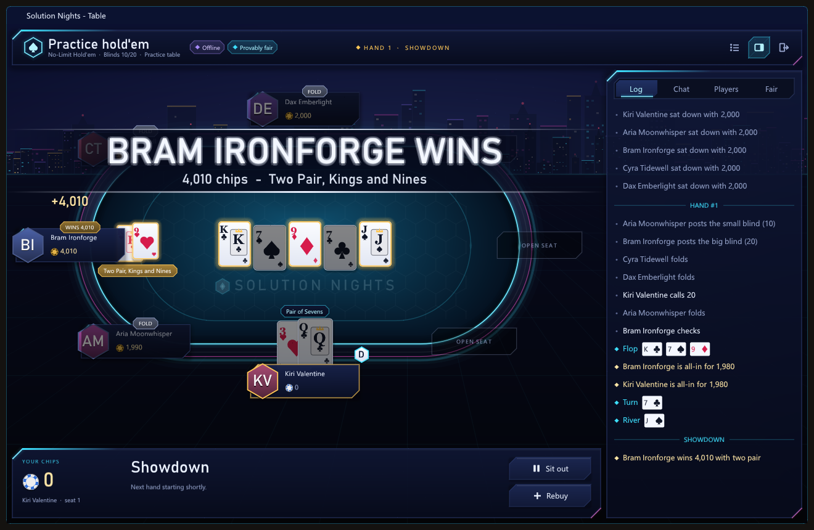
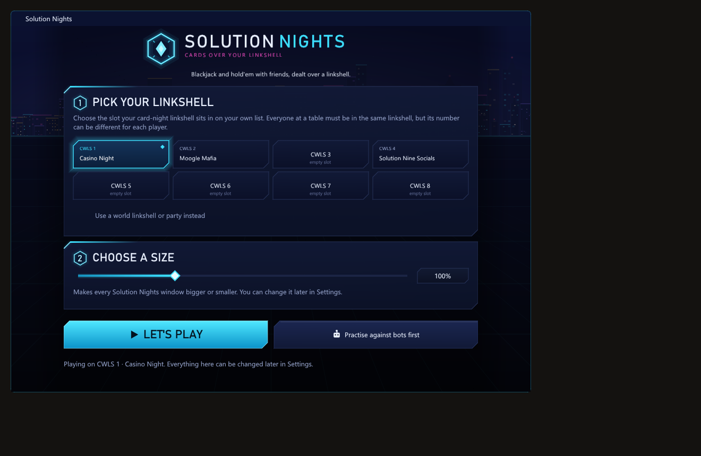
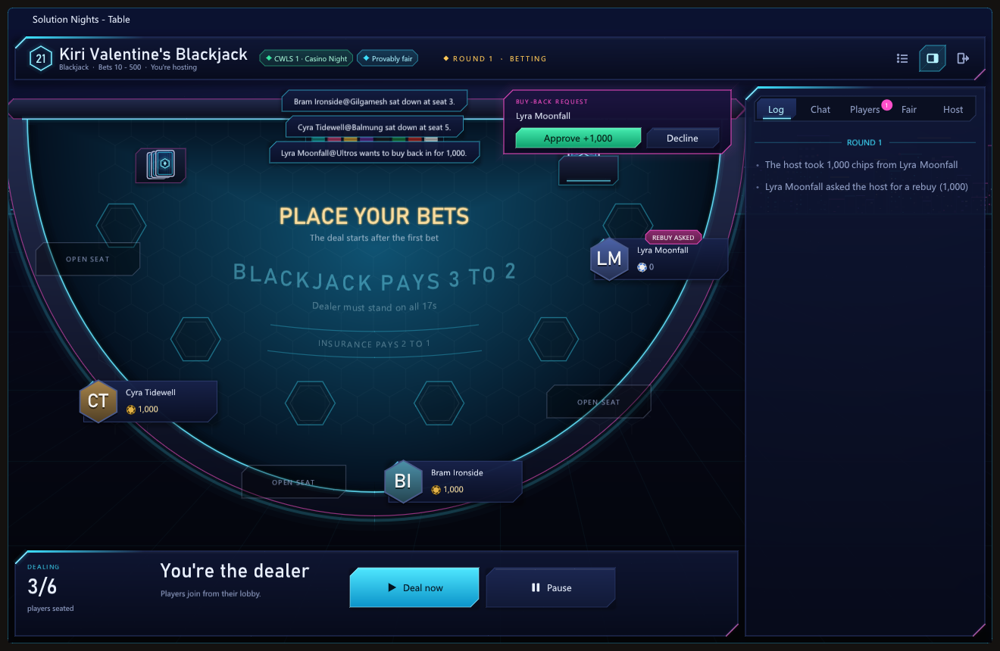
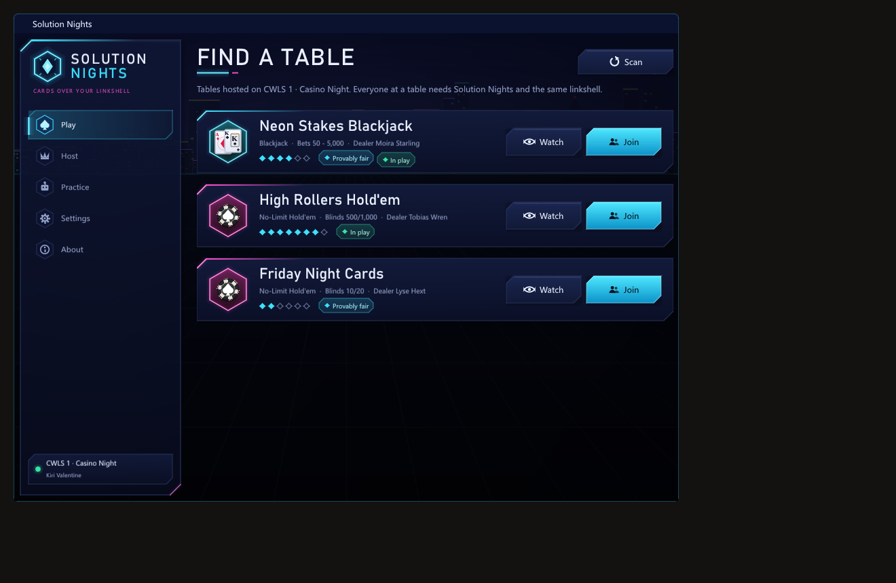

<div align="center">


# Solution Nights

**Blackjack, no-limit Texas Hold'em and roulette for FINAL FANTASY XIV, played with friends over a linkshell.**

*A neon card table in the spirit of Solution Nine. (It used to be called Saucer Nights.)*

One player hosts and deals. Everyone else finds the table in their lobby and joins with one click.
No servers, no ports, no accounts: the linkshell is the only connection.

[](https://github.com/lunaa-bit/SolutionNights/releases/latest)
[](https://github.com/lunaa-bit/SolutionNights/releases)
[](https://github.com/lunaa-bit/SolutionNights/actions/workflows/build.yml)


</div>

## Install

Solution Nights is a [Dalamud](https://github.com/goatcorp/Dalamud) plugin, so you need
[XIVLauncher](https://goatcorp.github.io/) first.

1. In game, type `/xlsettings` and open the **Experimental** tab.
2. Under **Custom Plugin Repositories**, paste this address, press **+**, then **Save and Close**:

   ```
   https://raw.githubusercontent.com/lunaa-bit/SolutionNights/main/repo.json
   ```

3. Type `/xlplugins`, search for **Solution Nights** and press **Install**.
4. Type `/snights` to open the lobby. The first time, a welcome screen asks which linkshell you play on and how big
   the windows should be.

Everyone at the table needs the plugin and has to be in the same linkshell. Updates arrive through the plugin
installer like any other plugin.

## Play

1. **Pick your linkshell.** The welcome screen (or *Settings* later) shows your cross-world linkshells by name; pick the
   one your group plays in. The slot number can be different for each player; it only has to be the same linkshell.
2. **Host a table.** Open *Host*, pick blackjack or hold'em, set the stakes and rules, and press **Open table**.
3. **Join.** Players open *Play*. Tables announce themselves about once a minute, and **Scan** asks right away.
   **Join** takes a seat; **Watch** spectates.
4. **Or practise.** *Practice* opens an offline table against bots. Nothing is sent to chat.

| Command | What it does |
|---|---|
| `/snights` | Open the lobby |
| `/snights table` | Open the table window |
| `/snights host bj` · `poker` · `roulette` | Open a table with your saved rules |
| `/snights practice bj` · `poker` · `roulette` | Play against bots |
| `/snights leave` | Leave the table (as host: close it) |
| `/snights settings` | Settings |

## What's in it

<table>
<tr>
<td width="50%"></td>
<td width="50%"></td>
</tr>
<tr>
<td width="50%"></td>
<td width="50%"></td>
</tr>
<tr>
<td width="50%"></td>
<td width="50%"></td>
</tr>
<tr>
<td width="50%"></td>
<td width="50%"></td>
</tr>
</table>

- **Blackjack.** The host is the house. Splits up to four hands, double, double after split, late surrender,
  insurance with dealer peek, 3:2 or 6:5 payouts, hit or stand on soft 17, one to eight decks.
- **No-limit Texas Hold'em.** Two to nine seats, blinds and antes, proper raise rules, side pots, uncalled bets and
  split pots.
- **European roulette.** Single zero, up to eight players, and every bet on the layout: straight, split, street,
  corner, six line, trios and the first four, dozens, columns and the even-money boxes, at the standard odds. Click the
  board to stack chips; the wheel spins after the betting window and every spin can be checked afterwards.
- **Show your cards.** When a hand ends, anyone who folded (or won without a showdown) can turn their cards over for
  the table.
- **A full table.** Drawn cards and chips, animated dealing and chip movement, turn timers, win banners, a game log,
  linkshell chat, and a choice of neon and classic felts and card backs.
- **Solution Nine at night.** The city skyline fills the window, with the header, side panel and controls floating
  over it as angular glass with neon trim.
- **Any size.** An interface size setting (75% to 160%) on top of Dalamud's own scale.
- **Host-approved buy-backs.** Topping back up to the starting stack always needs the host's OK, and a player who
  leaves and comes back gets the chips they left with, not a fresh stack.
- **Host tools.** Seat management, buy-back approval, pause, and a ledger of everyone's buy-ins and results.
- **Play money only.** Chips have no value in the game. The plugin never trades gil or items.

## Privacy and fairness

- **Hole cards are encrypted.** Each player's cards are sealed with a key shared only between them and the host, so
  nobody reading the linkshell can see them, with or without the plugin.
- **Game messages are coded and hidden.** Table traffic is sent as compact coded lines, paced to one line every
  1.2 seconds (adjustable). The plugin hides them from your chat log.
- **Provably fair shuffles (on by default).** The host commits to the shuffle before the deal, every player mixes in
  their own random seed, and afterwards each client checks the cards it saw. In hold'em only the board and the hands
  that were shown are opened, so folded hands stay secret.

### Cheating

- **A modified copy of the plugin can't read your cards.** The source is public on purpose: the protection comes from
  keys made fresh every time someone sits down (P-256 key exchange), not from hiding how the plugin works. A cheater
  with their own build only ever holds their own key, so everyone else's cards stay sealed. The test suite plays
  exactly that cheater, at the table and listening to every line.
- **Nobody can speak for the table or move for your seat.** The game stamps who sent every chat line. Clients only
  accept table messages from the host's character, the host only accepts moves for a seat from the player sitting
  there, and every move is checked against the rules and the turn.
- **No free chips.** Buying back in needs the host's approval, and leaving and coming back returns the chips you left
  with, so a busted player can't reset their stack.
- **What code can't stop.** The host's game deals, so it knows every card: pick a host you trust. Hold'em tables where
  the dealer also takes a seat are marked *Dealer plays* in the lobby and at the table, and that option is off by
  default. Friends telling each other their cards over voice chat is up to your group.

The details are in [docs/PROTOCOL.md](docs/PROTOCOL.md).

## Good to know

- **Linkshell members without the plugin see the coded lines** in their chat. A linkshell made just for card nights
  keeps everyone else's chat clean.
- **The plugin posts chat lines for you.** They are paced and only go to the channel you pick, but that is why
  Solution Nights is distributed from this repository and not the official Dalamud plugin list.
- **Third-party tools are not permitted by the game's terms of service.** Use plugins at your own risk, and don't
  talk about them in game chat.
- **Betting gil is between you and your friends.** The plugin only tracks play-money chips.

## Building from source

```
dotnet build SaucerNights/SaucerNights.csproj -c Release
dotnet test SaucerNights.Tests
```

See [docs/DEVELOPMENT.md](docs/DEVELOPMENT.md) for the project layout, the offline preview tool and how releases are
made.

## Disclaimer

Solution Nights is a fan-made project. It is not affiliated with or endorsed by Square Enix. FINAL FANTASY XIV is a
registered trademark of Square Enix Holdings Co., Ltd.
