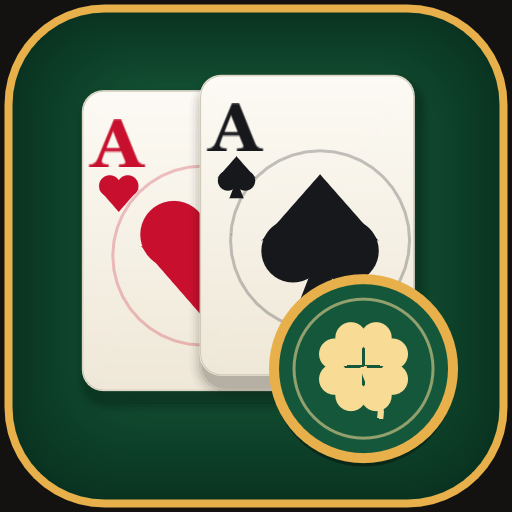
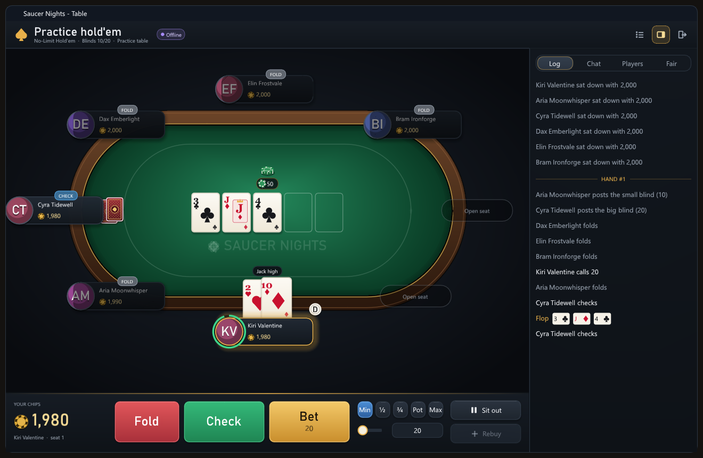
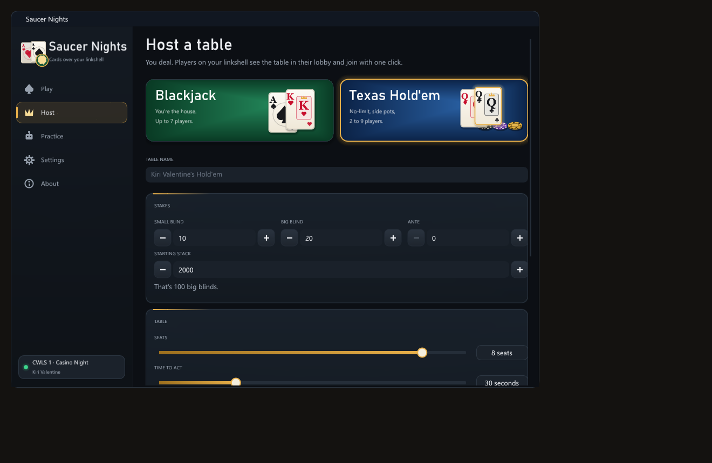

<div align="center">



# Saucer Nights

**Blackjack and no-limit Texas Hold'em for FINAL FANTASY XIV, played with friends over a linkshell.**

One player hosts and deals. Everyone else finds the table in their lobby and joins with one click.
No servers, no ports, no accounts: the linkshell is the only connection.

[](https://github.com/lunaa-bit/Saucer-Nights/releases/latest)
[](https://github.com/lunaa-bit/Saucer-Nights/releases)
[](https://github.com/lunaa-bit/Saucer-Nights/actions/workflows/build.yml)




</div>

## Install

Saucer Nights is a [Dalamud](https://github.com/goatcorp/Dalamud) plugin, so you need
[XIVLauncher](https://goatcorp.github.io/) first.

1. In game, type `/xlsettings` and open the **Experimental** tab.
2. Under **Custom Plugin Repositories**, paste this address, press **+**, then **Save and Close**:

   ```
   https://raw.githubusercontent.com/lunaa-bit/Saucer-Nights/main/repo.json
   ```

3. Type `/xlplugins`, search for **Saucer Nights** and press **Install**.
4. Type `/saucer` to open the lobby.

Everyone at the table needs the plugin and has to be in the same linkshell. Updates arrive through the plugin
installer like any other plugin.

## Play

1. **Pick your linkshell.** In *Settings*, choose the slot the shared linkshell sits in on your own list (default
   CWLS 1). The number can be different for each player; it only has to be the same linkshell.
2. **Host a table.** Open *Host*, pick blackjack or hold'em, set the stakes and rules, and press **Open table**.
3. **Join.** Players open *Play*. Tables announce themselves about once a minute, and **Scan** asks right away.
   **Join** takes a seat; **Watch** spectates.
4. **Or practise.** *Practice* opens an offline table against bots. Nothing is sent to chat.

| Command | What it does |
|---|---|
| `/saucer` | Open the lobby |
| `/saucer table` | Open the table window |
| `/saucer host bj` · `/saucer host poker` | Open a table with your saved rules |
| `/saucer practice bj` · `/saucer practice poker` | Play against bots |
| `/saucer leave` | Leave the table (as host: close it) |
| `/saucer settings` | Settings |

## What's in it

<table>
<tr>
<td width="50%"></td>
<td width="50%"></td>
</tr>
<tr>
<td width="50%"></td>
<td width="50%"></td>
</tr>
</table>

- **Blackjack.** The host is the house. Splits up to four hands, double, double after split, late surrender,
  insurance with dealer peek, 3:2 or 6:5 payouts, hit or stand on soft 17, one to eight decks.
- **No-limit Texas Hold'em.** Two to nine seats, blinds and antes, proper raise rules, side pots, uncalled bets and
  split pots.
- **Show your cards.** When a hand ends, anyone who folded (or won without a showdown) can turn their cards over for
  the table.
- **A full table.** Drawn cards and chips, animated dealing and chip movement, turn timers, win banners, a game log,
  linkshell chat, and a choice of felts and card backs.
- **Host tools.** Seat management, rebuy approval, pause, and a ledger of everyone's buy-ins and results.
- **Play money only.** Chips have no value in the game. The plugin never trades gil or items.

## Privacy and fairness

- **Hole cards are encrypted.** Each player's cards are sealed with a key shared only between them and the host, so
  nobody reading the linkshell can see them, with or without the plugin.
- **Game messages are coded and hidden.** Table traffic is sent as compact coded lines, paced to one line every
  1.2 seconds (adjustable). The plugin hides them from your chat log.
- **Provably fair shuffles (optional).** The host commits to the shuffle before the deal, every player mixes in their
  own random seed, and afterwards each client checks the cards it saw. In hold'em only the board and the hands that
  were shown are opened, so folded hands stay secret.
- **The host sees everything.** The host's game holds the deck, so play with a host you trust. In hold'em the host can
  also sit in; their client knows every card, so only do that among friends.

The details are in [docs/PROTOCOL.md](docs/PROTOCOL.md).

## Good to know

- **Linkshell members without the plugin see the coded lines** in their chat. A linkshell made just for card nights
  keeps everyone else's chat clean.
- **The plugin posts chat lines for you.** They are paced and only go to the channel you pick, but that is why
  Saucer Nights is distributed from this repository and not the official Dalamud plugin list.
- **Third-party tools are not permitted by the game's terms of service.** Use plugins at your own risk, and don't
  talk about them in game chat.
- **Betting gil is between you and your friends.** The plugin only tracks play-money chips.

## Building from source

```
dotnet build SaucerNights/SaucerNights.csproj -c Release
dotnet test SaucerNights.Tests
```

See [docs/DEVELOPMENT.md](docs/DEVELOPMENT.md) for the project layout, the offline preview tool and how releases are
made.

## Disclaimer

Saucer Nights is a fan-made project. It is not affiliated with or endorsed by Square Enix. FINAL FANTASY XIV is a
registered trademark of Square Enix Holdings Co., Ltd.
